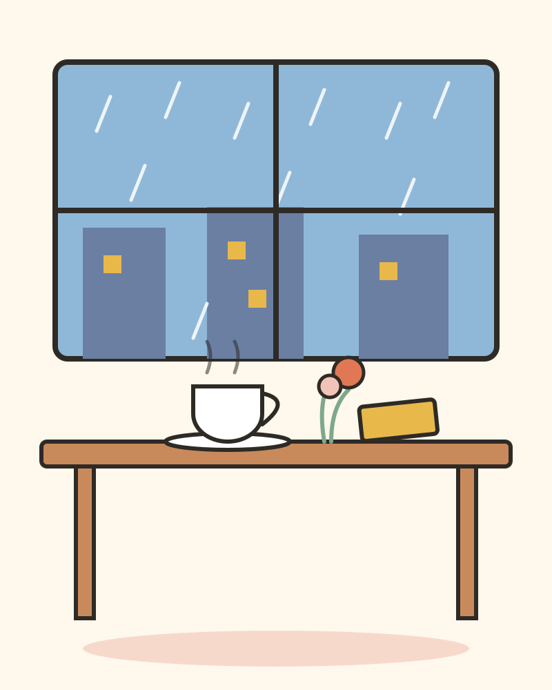

# 비 오는 날의 카페

비가 내리기 시작한 건 오후 세 시쯤이었다.

나는 우산이 없었다. 가방 속에 넣어 두었던 우산은 아침에 현관에 두고 온 뒤였다. 빗방울이 어깨를 적시기 시작할 때, 길 모퉁이에 작은 카페가 보였다. 유리창에 김이 서려 있고, 안에서는 따뜻한 불빛이 새어 나오고 있었다.

문을 열자 커피 향이 먼저 나를 맞았다. 카운터 안에서는 주인으로 보이는 아주머니가 컵을 닦고 있었다. 아주머니는 나를 보더니 말없이 수건으로 의자 하나를 닦아 주었다. 창가 자리였다. 빗방울이 유리창을 타고 내려가는 게 보였다.

"오늘 같은 날은 손님이 뜸해요."

아주머니가 따뜻한 커피를 내밀며 말했다. 나는 고개를 끄덕이고 컵을 두 손으로 감쌌다. 손끝이 조금씩 따뜻해졌다.

카페 한쪽에는 오래된 책장이 있었다. 책장 옆 탁자 위에는 누군가 두고 간 노트가 한 권 놓여 있었다. 표지에는 아무것도 적혀 있지 않았다. 펼쳐 보니 첫 장에 짧은 글 하나가 있었다.

'비가 오는 날에는, 천천히 가도 괜찮다.'

나는 그 문장을 한참 들여다보았다. 요즘 나는 늘 바빴다. 아침이면 달렸고, 점심이면 서둘렀고, 저녁이면 피곤했다. 천천히 간다는 건, 까맣게 잊은 말이었다.

밖에서는 비가 계속 내렸다. 그런데 이상하게도, 마음이 급하지 않았다. 커피를 한 모금 마시고, 창밖을 보고, 노트의 다음 장을 넘겼다. 다음 장에도 짧은 글이 있었다.

'오늘 하루, 잘한 일 하나만 기억하자.'

나는 오늘 잘한 일을 떠올려 보았다. 아침에 자리 하나를 양보한 일. 점심에 동료의 이름을 불러 준 일. 별것 아닌 일들이었다. 그런데 그 별것 아닌 일들이, 오늘 하루를 버티게 한 것 같았다.

어느새 비가 그치고 있었다. 유리창에 맺힌 물방울이 하나둘 마르기 시작했다. 나는 자리에서 일어났다. 아주머니가 문 쪽을 보며 말했다.

"다음에 비 오는 날 또 와요. 그때는 우산 가져오고."

나는 웃으며 고개를 끄덕였다. 문을 나서자 저녁 공기가 뺨에 닿았다. 길은 젖어 있었고, 가로등 불빛이 물웅덩이에 반사되어 반짝였다.

그날 나는 천천히 걸었다. 비 오는 날에는, 천천히 가도 괜찮으니까.
